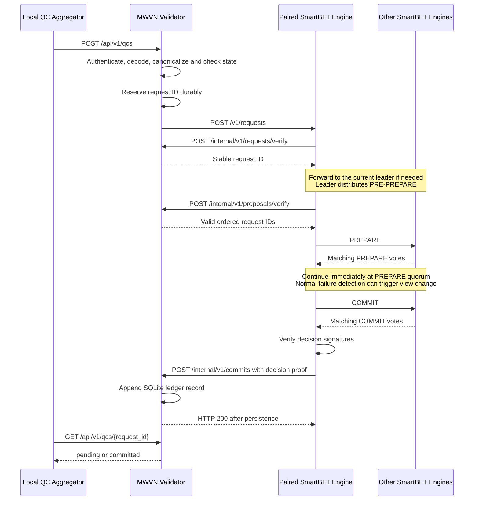

# MWVN SmartBFT Engine Design

## Start here

The repository has two layers:

1. The original SmartBFT library implements consensus, quorum, leader change,
   and protocol persistence.
2. `cmd/mwvn_bftnode` turns that library into an HTTP service and connects one
   SmartBFT participant to one Python MWVN Regional Validator.

The most important boundary is that Go orders commands while Python validates
and applies them. `OPEN_WINDOW`, `RECORD_QC`, and `CLOSE_WINDOW` are
application commands, not new SmartBFT protocol messages. Python owns their
state machine and 300-second collection policy. SmartBFT uses its standard
request, heartbeat, and view-change timers.

For a first reading, use sections 1, 4, and 5. Sections 6 and 7 are the runtime
reference for the HTTP API, persistence, recovery, and known limitations.

## Main algorithms

### Fault tolerance and quorum

For membership size `N`, SmartBFT calculates:

```text
f = floor((N - 1) / 3)
Q = ceil((N + f + 1) / 2)
```

`f` is the tolerated Byzantine-fault count and `Q` is the vote quorum. Any two
quorums intersect in enough members to prevent two conflicting certified
decisions at the same sequence under the fault assumption. Examples: N=4 gives
f=1 and Q=3; N=7 gives f=2 and Q=5.

### Normal consensus round

**Input:** one request already admitted by a Python Validator.

1. A non-leader forwards the request to the current leader.
2. The leader creates the next proposal, binding sequence, previous
   application-ledger hash, payload hash, and SmartBFT view metadata.
3. The leader broadcasts `PRE-PREPARE`.
4. Every engine verifies proposal structure and asks its paired Validator to
   verify the command against that Validator's current application state.
5. Engines exchange signed `PREPARE` votes for the same proposal digest.
6. At prepare quorum, engines exchange signed `COMMIT` votes.
7. At commit quorum, each engine has a certified decision and delivers the same
   ordered proposal to its paired Validator.

An engine signature proves a consensus vote. It does not prove that maritime
evidence is valid; application validation remains in Python.

### View change

Request, heartbeat, and view-change timers detect a leader that is unavailable
or not making progress. Engines move to the next deterministic view, exchange
signed view-change data, and wait for quorum. The new leader preserves any
proposal that already has the required prepared evidence; otherwise it starts
from the last certified decision. Application evidence-window deadlines do not
alter this protocol or suppress failure detection.

### Application-aware proposal lifecycle

The adapter asks the paired Validator to verify a request before pooling it and
to verify the proposal before voting. A proposal records the Validator ledger
height used for verification. After a commit advances that height, pending
requests are checked again so a command that conflicts with newly committed
state cannot remain eligible.

For `mwvn-command/v1`, a proposal contains exactly one command. The engine
checks proposal schema, payload hash, metadata sequence, network, and
membership, while the paired Validator checks evidence policy and application
state.

### Certified decision persistence and delivery

1. Verify at least `Q` distinct signatures from known membership keys.
2. Reject duplicate, unknown, forged, wrong-network, or wrong-membership
   signers and decisions.
3. Persist the exact proposal and signatures under
   `decisions/<sequence>.json` and sync the directory.
4. Convert the decision to the application-facing commit callback.
5. Send it to the paired Validator with the pair's internal API key.
6. Treat delivery as complete only after the Validator durably commits its
   SQLite transaction and returns success.

The engine WAL records protocol progress; the decision archive proves and
redelivers certified order. Neither is the authoritative application ledger.

### Restart and certified catch-up

1. Read the paired Validator's ledger height and head.
2. Load local decisions in sequence, verify each full quorum proof, and
   redeliver idempotently.
3. If certified sequences are missing, request pages beginning at
   `validator_height + 1` from authenticated peers.
4. For every returned record, verify network, membership, exact next sequence,
   proposal structure, payload hash, chain linkage, distinct signers,
   signatures, and quorum.
5. Persist and apply one valid decision at a time, then restore the latest
   SmartBFT checkpoint and WAL position.

A peer's claimed height is never trusted by itself. Catch-up accepts only a
contiguous chain of independently verified certified decisions.

## MWVN engine behavior

Each engine performs the following work:

1. It accepts one application command that its paired Python validator has
   already admitted.
2. It asks the paired validator to verify the command before adding it to the
   request pool.
3. The current leader proposes one command for the next ledger position.
4. Every engine asks its own paired validator to verify the proposal against
   that validator's current application state.
5. SmartBFT orders the proposal after the required quorum of engines agrees.
6. Each engine verifies the decision signatures, stores the certified decision,
   and sends the commit to its paired validator.
7. The validator applies the command to its authoritative SQLite ledger and
   acknowledges the callback after durable storage.

### Keeping pending commands valid

A command can be valid when it enters the request pool and become invalid after
another command commits. For example, two nodes may try to close the same
window. The engine therefore associates proposals with the validator's current
ledger height. After a commit advances that height, SmartBFT sends pending
commands through validation again. Commands that no longer match the committed
application state are rejected before they can enter a later proposal.

### Restart and catch-up

An engine restart preserves two kinds of state:

- the SmartBFT write-ahead log, which records consensus progress; and
- the certified decision archive, which records committed proposals and their
  quorum signatures.

Before rejoining consensus, the engine verifies its local archive and aligns it
with the paired validator's ledger. If decisions are missing, it requests them
in sequence from authenticated peers. A peer cannot make the engine accept a
decision merely by claiming a higher ledger position. The engine independently
checks the network and membership, sequence number, previous record hash,
proposal contents, distinct signers, signatures, and required quorum. The
Python validator then checks and applies the recovered application transition.

### Paired-validator availability

Every callback from the Go engine to its Python validator carries the pair's
`MWVN_INTERNAL_API_KEY`. Different validator/engine pairs use different keys.

With `-application-watchdog` enabled, the engine checks every two seconds that
its paired validator is running the expected window scheduler. Three
consecutive failures cause the engine to stop while retaining its WAL and
decision archive. If that engine was the leader, normal SmartBFT failure
detection moves the cluster to another leader. The process supervisor can then
restart the stopped pair without discarding its durable state.

### Status and trust boundary

`GET /v1/status` shows whether the engine is ready or recovering, its node ID,
the current leader, network and membership versions, peer count, application
command version, and the paired validator's ledger height and head hash.

The Go engine verifies peer identity, SmartBFT messages, proposal structure, and
the individual Ed25519 signatures that form a consensus decision proof. The
Python validator verifies witness and Aggregator signatures and owns all
application decisions: evidence policy, window deadlines, classification, late
amendments, ledger transitions, and the authoritative application state.

## 1. Purpose and boundary

This fork turns the SmartBFT library into a runnable consensus-engine service for
the MWVN regional layer. The new Go application is `cmd/mwvn_bftnode`.

It is important to separate the responsibilities:

| Component | Responsibility |
|---|---|
| MWVN Regional Validator (Python, separate repository) | Receive a local QC, decode and validate it, apply expiry/replay/policy/state-machine rules, expose application status, and own the durable regional ledger. |
| `mwvn_bftnode` (Go, this repository) | Order requests already admitted by the Python validator, exchange authenticated SmartBFT messages with other engines, verify validator decision signatures, and return committed decisions to the paired validator. |
| SmartBFT library (Go, this repository) | Run the PBFT-family consensus protocol, including proposal, PREPARE, COMMIT, view change, batching, and write-ahead logging. |
| Regional deployment (separate repository) | Configure and run four Python validators and four paired Go engines, their membership, keys, containers, and end-to-end tests. |

The simulator and Local QC Aggregator call the Python Regional Validator. They do
not call a Go consensus engine directly. The Go application is not a complete
MWVN validator and does not know the witness-event or local-QC policy.

### One request from submission to commitment

```mermaid
flowchart LR
    A["1. Local QC Aggregator"] -->|Signed Local QC| V1["2. Validator 1 validates it"]
    V1 -->|Admitted command| E["3. Current SmartBFT leader"]
    E --> P["4. Four engine-validator pairs verify and vote"]
    P -->|At least 3 of 4 engines agree| D["5. Certified decision"]
    D --> L["6. Four validators update their own ledgers"]
    L --> S["7. Validator 1 reports committed"]
```



The numbered steps mean:

1. The Local QC Aggregator sends a signed Local QC to Validator 1. It never
   submits directly to SmartBFT.
2. Validator 1 checks the QC, signatures, replay rules, evidence policy, and
   current application state. If the QC is valid, it creates an application
   command.
3. Validator 1 gives the command to Engine 1. If Engine 1 is not the current
   leader, it forwards the command to the leader.
4. The leader proposes the command to all four engines. Before voting, each
   engine asks its own paired Python validator whether the proposal is valid.
5. The engines exchange SmartBFT votes. With four engines, at least three must
   agree. Their signatures form the certified decision.
6. Every engine sends that same decision to its paired validator. Each validator
   verifies it and appends the command to its own SQLite ledger. The four
   ledgers are independent copies of the same ordered application history.
7. The Aggregator can query Validator 1 and see that the request is committed.

The deployment always pairs the components:

| Pair | Python application | Go consensus process |
|---|---|---|
| 1 | Validator 1 and Ledger 1 | Engine 1 |
| 2 | Validator 2 and Ledger 2 | Engine 2 |
| 3 | Validator 3 and Ledger 3 | Engine 3 |
| 4 | Validator 4 and Ledger 4 | Engine 4 |

Each validator uses only its paired engine for consensus. Each engine
communicates with all other engines to run SmartBFT. This pairing lets every
validator independently check the proposal before voting and independently
apply the decision after consensus.

## 2. Upstream SmartBFT v1.0.1 structure

Before the MWVN changes, the upstream tag `v1.0.1` had this top-level structure:

```text
SmartBFT/
├── .github/                 CI and repository automation
├── examples/
│   └── naive_chain/         Example embedding of the SmartBFT library
├── internal/
│   └── bft/                 Internal consensus protocol implementation
├── pkg/
│   ├── api/                 Dependency interfaces and metrics
│   ├── consensus/           Public consensus facade
│   ├── metrics/             Metrics providers
│   ├── types/               Public configuration and protocol types
│   └── wal/                 Write-ahead-log implementation
├── scripts/                 Upstream development scripts
├── smartbftprotos/          Consensus protocol protobuf definitions
├── test/                    Multi-node protocol and reconfiguration tests
├── vendor/                  Vendored Go dependencies
├── go.mod
├── go.sum
├── LICENSE
└── README.md
```

Upstream SmartBFT is a Go library. It defines the consensus algorithm and the
interfaces an embedding application must supply, but it does not provide an
MWVN-aware HTTP server, an MWVN membership file, or a Python validator.

## 3. Structure after the MWVN changes

The original directories remain. The fork adds a runnable adapter, documentation,
tests, application commands, and certified recovery:

```text
SmartBFT/
├── cmd/mwvn_bftnode/
│   ├── main.go, config.go      process lifecycle and membership
│   ├── node.go                application-command adapter
│   ├── callback.go            paired Python callbacks
│   ├── transport.go, server.go authenticated peer transport / API
│   ├── recovery.go            certified history and restart
│   ├── watchdog.go            paired application health
│   └── *_test.go              membership, proof, peer and recovery tests
├── internal/bft/              upstream v1.0.1 protocol implementation
├── pkg/consensus/, pkg/types/ upstream v1.0.1 consensus/configuration
├── test/                      upstream protocol regression tests
├── docs/                      design and installation guides
└── Makefile                   adapter and consensus test targets
```

Deployment-only files are deliberately absent. The generated Compose files,
membership, development keys, and cross-repository end-to-end test live in
`mwvn-regional-deployment`. The full MWVN validation/state-machine code lives in
`mwvn-validator`.

## 4. The application added to use SmartBFT

### 4.1 Why an adapter was needed

SmartBFT is embedded through Go interfaces; it is not an HTTP service by itself.
`mwvn_bftnode` supplies the interfaces and process plumbing needed to operate one
independent engine:

- `Comm`: send consensus messages and forwarded transactions to known peers;
- `Signer`: sign proposals and view data with the node's Ed25519 identity;
- `Verifier`: delegate application/QC validation to the paired Python validator
  and verify SmartBFT validator signatures;
- `Assembler`: build a deterministic proposal from admitted requests;
- `Application`: deliver a committed proposal to the paired Python validator;
- `Synchronizer`: expose limited in-process state required by SmartBFT;
- `WAL`: persist SmartBFT protocol state.

The adapter starts one `consensus.Consensus` instance per process. A generated
`N`-validator deployment therefore runs `N` Go processes and `N` paired Python
processes. SmartBFT derives `N` from membership and calculates `f` and its safe
quorum. For the default `N=4`, it tolerates `f=1` Byzantine validator and
decides with quorum `3`; for `N=7`, it tolerates `f=2` and uses quorum `5`.

### 4.2 Request and decision flow



An HTTP `202` from `/v1/requests` means only that SmartBFT accepted the request
for processing. It is not proof of commitment. The client reads final state from
the Python validator API.

The diagram follows one paired validator and engine. Every engine verifies the
proposal with its own Python validator before voting and delivers the decided
record to that validator after consensus. Proposal verification therefore
appears before PREPARE, rather than after the COMMIT votes.

### 4.3 Membership and transport

At startup, `config.go` loads a strict JSON membership document containing:

- a network ID and membership version;
- at least four validator IDs;
- each engine's HTTP peer URL;
- each engine's Ed25519 public key.

`transport.go` sends protobuf SmartBFT messages and JSON forwarded requests over
HTTP. Every peer request carries the network ID, sender ID, and an Ed25519
signature covering the protocol domain, network ID, path, and exact body bytes.
This is suitable for an isolated experiment; production deployment still needs
TLS/mTLS, stronger authorization, replay protection, and production secret
management.

## 5. Evidence collection belongs to the application

OPEN_WINDOW, RECORD_QC and CLOSE_WINDOW are application commands ordered by
ordinary SmartBFT. The Python state machine owns the committed deadline and
deterministic classification. Each command can commit immediately on quorum;
other windows can make progress while evidence is being collected.

The replacement leader recovers committed OPEN windows and their original
deadlines. It proposes eligible closures; all replicas validate the evidence
set and classification before voting. The Python DESIGN.md describes this
state machine and the late-evidence policy.

Evidence-window timing does not change SmartBFT protocol timers. Normal request,
heartbeat, and view-change processing remains active while application windows
are open. The MWVN integration uses the existing SmartBFT protocol messages and
quorum rules.

N=4 and N=7 use the existing SmartBFT quorum formula. Decision proofs remain
Ed25519 signature lists; BLS aggregation is not implemented.

## 6. HTTP API summary

This section consolidates the engine's HTTP surface in the design document.
Implementation routes are defined in `cmd/mwvn_bftnode/server.go`; callbacks are
defined in `cmd/mwvn_bftnode/callback.go`.

### 6.1 Python validator to Go engine

| Method | Path | Purpose | Success |
|---|---|---|---|
| `GET` | `/v1/health` | Engine readiness and node ID. | `200`; `503` while starting |
| `GET` | `/v1/status` | Node-local leader, membership, paired-ledger state and recovery status. | `200` |
| `POST` | `/v1/requests` | Submit one request already admitted by the Python validator. | `202 pending` |
| `GET` | `/v1/trace?after=0&limit=500` | Read bounded node-local protocol trace events. | `200` |

#### Request submission

The paired validator submits one complete application command. The engine
treats the command as application data and asks the validator to verify it
before accepting it into the SmartBFT request pool.

```http
POST /v1/requests
Content-Type: application/json

{
  "schema_version": "mwvn-command/v1",
  "request_id": "dddddddddddddddddddddddddddddddddddddddddddddddddddddddddddddddd",
  "network_id": "mwvn-regional-demo",
  "membership_version": 1,
  "policy_hash": "eeeeeeeeeeeeeeeeeeeeeeeeeeeeeeeeeeeeeeeeeeeeeeeeeeeeeeeeeeeeeeee",
  "command_type": "CLOSE_WINDOW",
  "payload": {
    "window_id": "ffffffffffffffffffffffffffffffffffffffffffffffffffffffffffffffff",
    "opening_command": "aaaaaaaaaaaaaaaaaaaaaaaaaaaaaaaaaaaaaaaaaaaaaaaaaaaaaaaaaaaaaaaa",
    "deadline_ms": 1793873100000,
    "evidence_digest": "1111111111111111111111111111111111111111111111111111111111111111",
    "classification": "INSUFFICIENT_QUORUM"
  },
  "admissions": [
    {"node_id": 1, "signature": "<base64 Ed25519 admission signature>"},
    {"node_id": 2, "signature": "<base64 Ed25519 admission signature>"},
    {"node_id": 3, "signature": "<base64 Ed25519 admission signature>"}
  ]
}
```

| Value | Meaning |
|---|---|
| `schema_version` | Application-command format. Version 1 commands are placed in SmartBFT proposal version 2. |
| `request_id` | Stable SHA-256 command identity returned in the `202` response and used for deduplication. |
| `network_id` | Consensus network that may order the command. It must match engine membership. |
| `membership_version` | Membership and key version used to verify command admissions. |
| `policy_hash` | Hash of the retained validator policy that determines the application result. |
| `command_type` | Application operation. The current values are `OPEN_WINDOW`, `RECORD_QC`, and `CLOSE_WINDOW`. |
| `payload` | Command-specific application data. The Python validator defines and verifies these fields. |
| `payload.window_id` | Stable identity of the committed evidence window being closed. |
| `payload.opening_command` | Request ID of the committed `OPEN_WINDOW` command; it binds closure to the original opening. |
| `payload.deadline_ms` | Original committed deadline in Unix milliseconds. A new leader cannot replace it. |
| `payload.evidence_digest` | SHA-256 digest of the sorted committed QC identities included in the result. |
| `payload.classification` | Deterministic result recomputed by every paired validator before its engine votes. |
| `admissions` | Distinct validator approvals for the exact command. The certificate must reach quorum. |
| `admissions[].node_id` | Validator that approved the command. |
| `admissions[].signature` | Base64 Ed25519 signature over the canonical command body. Placeholders in this example are not usable signatures. |

The complete command payloads and every application field are documented in
the `mwvn-validator` `docs/DESIGN.md`. This engine does not interpret evidence,
classification, or window-policy fields.

An accepted request returns HTTP `202`:

```json
{
  "state": "pending",
  "request_id": "dddddddddddddddddddddddddddddddddddddddddddddddddddddddddddddddd",
  "node_id": 1
}
```

| Value | Meaning |
|---|---|
| `state` | `pending` means the engine accepted the request into its pool. It does not mean consensus has committed it. |
| `request_id` | Identity returned by the paired validator after request verification. |
| `node_id` | Engine that accepted the request. It may forward the request if another engine is leader. |

#### Status response

`GET /v1/status` returns node-local engine and paired-ledger state:

```json
{
  "status": "ok",
  "application_command_version": 1,
  "node_id": 1,
  "leader_id": 2,
  "membership_version": 1,
  "network_id": "mwvn-regional-demo",
  "peer_count": 4,
  "ledger_height": 12,
  "ledger_head": "2222222222222222222222222222222222222222222222222222222222222222",
  "process_model": "one independent SmartBFT consensus-engine process"
}
```

| Value | Meaning |
|---|---|
| `status` | `ok` when recovery is complete; `recovering` while startup restoration or catch-up is in progress. |
| `application_command_version` | Application command version supported by this adapter. |
| `node_id` | This engine's membership ID. |
| `leader_id` | Current SmartBFT leader known by this engine. Leadership may change after a timeout or failure. |
| `membership_version` | Active membership/key version. |
| `network_id` | Active consensus network. |
| `peer_count` | Number of engines in membership, including this engine. |
| `ledger_height` | Last sequence durably applied by the paired Python validator. |
| `ledger_head` | Hash of that validator's latest ledger record. |
| `process_model` | Reminder that this status describes one engine process, not the whole cluster. |

### 6.2 Go engine to its paired Python validator

| Method | Path | Purpose |
|---|---|---|
| `GET` | `/internal/v1/state` | Read paired node ID, application-ledger height, and head hash. |
| `GET` | `/internal/v1/runtime` | Check evidence-window mode and scheduler health when the optional watchdog is enabled. |
| `POST` | `/internal/v1/requests/verify` | Deterministically validate one submitted request and return its ID. |
| `POST` | `/internal/v1/proposals/verify` | Validate proposal contents and application-ledger linkage. |
| `POST` | `/internal/v1/commits` | Deliver the decided record and verified SmartBFT decision proof for durable storage. |

These callback endpoints are implemented by `mwvn-validator`, not by this Go
repository.

Every callback includes `X-MWVN-Internal-Key`. The validator rejects a missing
or incorrect key.

#### Proposal verification callback

Before voting, an engine sends its paired validator the proposal header and
the single proposed command:

```json
{
  "header": {
    "schema_version": "mwvn-smartbft-proposal/v2",
    "sequence": 12,
    "previous_hash": "2222222222222222222222222222222222222222222222222222222222222222",
    "data_hash": "3333333333333333333333333333333333333333333333333333333333333333"
  },
  "commands": [
    {
      "schema_version": "mwvn-command/v1",
      "request_id": "dddddddddddddddddddddddddddddddddddddddddddddddddddddddddddddddd",
      "network_id": "mwvn-regional-demo",
      "membership_version": 1,
      "policy_hash": "eeeeeeeeeeeeeeeeeeeeeeeeeeeeeeeeeeeeeeeeeeeeeeeeeeeeeeeeeeeeeeee",
      "command_type": "CLOSE_WINDOW",
      "payload": {
        "window_id": "ffffffffffffffffffffffffffffffffffffffffffffffffffffffffffffffff",
        "opening_command": "aaaaaaaaaaaaaaaaaaaaaaaaaaaaaaaaaaaaaaaaaaaaaaaaaaaaaaaaaaaaaaaa",
        "deadline_ms": 1793873100000,
        "evidence_digest": "1111111111111111111111111111111111111111111111111111111111111111",
        "classification": "INSUFFICIENT_QUORUM"
      },
      "admissions": [
        {"node_id": 1, "signature": "<base64 signature>"},
        {"node_id": 2, "signature": "<base64 signature>"},
        {"node_id": 3, "signature": "<base64 signature>"}
      ]
    }
  ]
}
```

| Value | Meaning |
|---|---|
| `header.schema_version` | `mwvn-smartbft-proposal/v2` identifies a proposal containing one application command. |
| `header.sequence` | Proposed application-ledger sequence. It must extend the paired validator's current height. |
| `header.previous_hash` | Expected current application-ledger head. It prevents ordering a command on the wrong state. |
| `header.data_hash` | SHA-256 digest of the exact proposal payload produced by the engine. |
| `commands` | Exactly one `mwvn-command/v1` object. Version 2 proposals cannot mix this with `approved_qcs`. |

The validator returns the ordered request identity after repeating command,
policy, and state checks:

```json
{
  "request_ids": [
    "dddddddddddddddddddddddddddddddddddddddddddddddddddddddddddddddd"
  ]
}
```

`request_ids` contains the validator-approved identity for each proposed item,
in proposal order. Version 2 currently contains exactly one item, so this list
must contain exactly one non-empty value.

#### Commit delivery callback

After SmartBFT reaches quorum, each engine verifies the signatures, archives
the certified decision, and sends this application-facing record to its paired
validator:

```json
{
  "schema_version": "mwvn-bft-commit/v2",
  "node_id": 1,
  "sequence": 12,
  "view": 3,
  "previous_hash": "2222222222222222222222222222222222222222222222222222222222222222",
  "proposal_digest": "4444444444444444444444444444444444444444444444444444444444444444",
  "commands": [
    {
      "schema_version": "mwvn-command/v1",
      "request_id": "dddddddddddddddddddddddddddddddddddddddddddddddddddddddddddddddd",
      "network_id": "mwvn-regional-demo",
      "membership_version": 1,
      "policy_hash": "eeeeeeeeeeeeeeeeeeeeeeeeeeeeeeeeeeeeeeeeeeeeeeeeeeeeeeeeeeeeeeee",
      "command_type": "CLOSE_WINDOW",
      "payload": {
        "window_id": "ffffffffffffffffffffffffffffffffffffffffffffffffffffffffffffffff",
        "opening_command": "aaaaaaaaaaaaaaaaaaaaaaaaaaaaaaaaaaaaaaaaaaaaaaaaaaaaaaaaaaaaaaaa",
        "deadline_ms": 1793873100000,
        "evidence_digest": "1111111111111111111111111111111111111111111111111111111111111111",
        "classification": "INSUFFICIENT_QUORUM"
      },
      "admissions": [
        {"node_id": 1, "signature": "<base64 signature>"},
        {"node_id": 2, "signature": "<base64 signature>"},
        {"node_id": 3, "signature": "<base64 signature>"}
      ]
    }
  ],
  "decision_proof": [
    {"validator_id": 1, "value": "<base64 consensus signature>", "auxiliary": "<base64 signed auxiliary data>"},
    {"validator_id": 2, "value": "<base64 consensus signature>", "auxiliary": "<base64 signed auxiliary data>"},
    {"validator_id": 3, "value": "<base64 consensus signature>", "auxiliary": "<base64 signed auxiliary data>"}
  ]
}
```

| Value | Meaning |
|---|---|
| `schema_version` | `mwvn-bft-commit/v2` identifies a decided application command. |
| `node_id` | Engine-validator pair receiving and applying this callback. |
| `sequence` | Committed application-ledger sequence. |
| `view` | SmartBFT view that produced the decision. |
| `previous_hash` | Application-ledger record that this decision extends. |
| `proposal_digest` | SmartBFT digest of the exact decided proposal. |
| `commands` | The one command ordered by the decision. |
| `decision_proof` | Quorum of distinct engine signatures. With four members, at least three valid signatures are required. |
| `decision_proof[].validator_id` | Membership ID of the signing engine. |
| `decision_proof[].value` | Base64 Ed25519 consensus signature. |
| `decision_proof[].auxiliary` | Base64 signed SmartBFT auxiliary bytes bound to the proposal. |

### 6.3 Go engine peer API

| Method | Path | Body | Purpose |
|---|---|---|---|
| `POST` | `/internal/v1/consensus` | SmartBFT protobuf | Deliver PRE-PREPARE, PREPARE, COMMIT, view-change, heartbeat, and state-transfer protocol messages. |
| `POST` | `/internal/v1/transaction` | JSON application request | Forward a request to the current leader. |
| `POST` | `/internal/v1/decisions` | JSON archive range | Return a bounded page of certified decisions for peer recovery. |

All three routes require `X-MWVN-Network`, `X-MWVN-Sender`, and
`X-MWVN-Signature`. They are private engine-to-engine routes; neither the
simulator nor the Python validator should call them.

For example, an engine requesting recovery records beginning at sequence 13
sends:

```http
POST /internal/v1/decisions
Content-Type: application/json
X-MWVN-Network: mwvn-regional-demo
X-MWVN-Sender: 2
X-MWVN-Signature: <base64 Ed25519 transport signature>

{"from": 13}
```

| Value | Meaning |
|---|---|
| `X-MWVN-Network` | Network identity; it must exactly match the receiving engine's membership. |
| `X-MWVN-Sender` | Numeric membership ID of the sending engine. |
| `X-MWVN-Signature` | Base64 Ed25519 signature over the network ID, request path, and exact request body. |
| `from` | First required decision sequence. The response contains at most 16 contiguous archive records. |

The response envelope is:

```json
{
  "records": [
    {
      "network_id": "mwvn-regional-demo",
      "membership_version": 1,
      "decision": {
        "Proposal": {
          "Payload": "<base64 proposal payload bytes>",
          "Header": "<base64 proposal header bytes>",
          "Metadata": "<base64 SmartBFT metadata bytes>",
          "VerificationSequence": 12
        },
        "Signatures": [
          {"ID": 1, "Value": "<base64 signature>", "Msg": "<base64 auxiliary bytes>"},
          {"ID": 2, "Value": "<base64 signature>", "Msg": "<base64 auxiliary bytes>"},
          {"ID": 3, "Value": "<base64 signature>", "Msg": "<base64 auxiliary bytes>"}
        ]
      }
    }
  ]
}
```

| Value | Meaning |
|---|---|
| `records` | Sequential certified decisions starting at `from`; an empty list means that peer has no record at that sequence. |
| `network_id` | Network bound to the archived decision. |
| `membership_version` | Membership/key version under which the decision was certified. |
| `decision.Proposal.Payload` | Base64 JSON proposal payload bytes. They are decoded and hashed before use. |
| `decision.Proposal.Header` | Base64 JSON proposal-header bytes containing sequence, previous hash, and data hash. |
| `decision.Proposal.Metadata` | Base64 SmartBFT view metadata bytes. |
| `decision.Proposal.VerificationSequence` | Application height at which the proposal was originally verified. |
| `decision.Signatures` | Individual SmartBFT decision signatures retained in the archive. |
| `decision.Signatures[].ID` | Signing engine's membership ID. |
| `decision.Signatures[].Value` | Base64 Ed25519 signature bytes. |
| `decision.Signatures[].Msg` | Base64 auxiliary bytes covered by the signature. |

Recovery verifies network, membership, sequence continuity, previous-hash
linkage, payload hashes, distinct known signers, and quorum before applying any
record. Recovery records transfer an existing certified decision; they do not
create a new consensus decision.

## 7. Persistence and current limitations

The authoritative MWVN application ledger is the SQLite ledger owned by each
Python validator. It contains the applied commands and resulting application
state. This Go repository does not contain a second authoritative ledger.

The Go engine keeps the records needed to prove, resume, and redeliver consensus
under its configured `-data-dir`:

| Path | Contents | Purpose |
|---|---|---|
| `wal/` | SmartBFT protocol records | Resume consensus after restart |
| `decisions/<sequence>.json` | Exact proposal and quorum signatures | Verify recovery, serve peer catch-up, and retry application delivery |

The engine writes and syncs a certified decision before calling the paired
validator. The validator applies the command to its SQLite ledger and returns a
successful callback only after durable storage. Repeating that callback is
idempotent, which handles a lost acknowledgement safely.

The common application record hash excludes a node-local decision-proof subset
because two honest nodes can hold different valid 3-of-4 signature subsets for
the same decision.

Current limitations are intentional and must remain visible:

- new certified archives support ledger/WAL restart and application catch-up;
- old ledgers without matching archives need reviewed migration;
- Go-to-Python callbacks support per-pair authentication; keep the Go submission
  API private (submitted commands are independently application-verified);
- peer HTTP is signed but not encrypted and has no replay protection;
- keys in the deployment repository are development-only;
- the engine orders admitted opaque requests; it does not implement MWVN QC
  validation or the MWVN conflict-preserving state machine.

## 8. Repository relationships

```text
mwvn-local-aggregator
    -> sends local QCs to mwvn-validator

mwvn-validator
    -> owns MWVN rules and the application ledger
    -> calls one SmartBFT engine through this repository's API

SmartBFT (this repository)
    -> owns the consensus protocol and mwvn_bftnode adapter

mwvn-regional-deployment
    -> assembles four mwvn-validator instances and four SmartBFT engines
```

Keeping these boundaries allows the PBFT-family engine to be replaced later
without moving MWVN validation policy into the consensus library.
