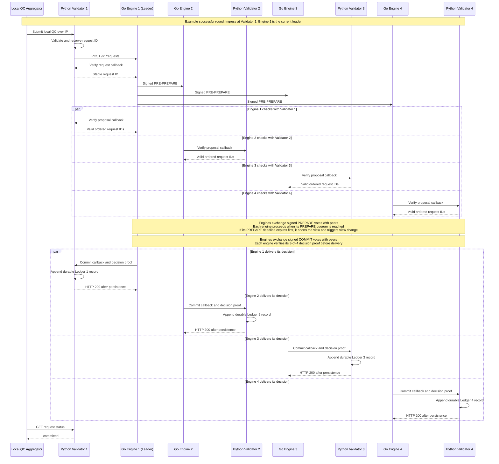
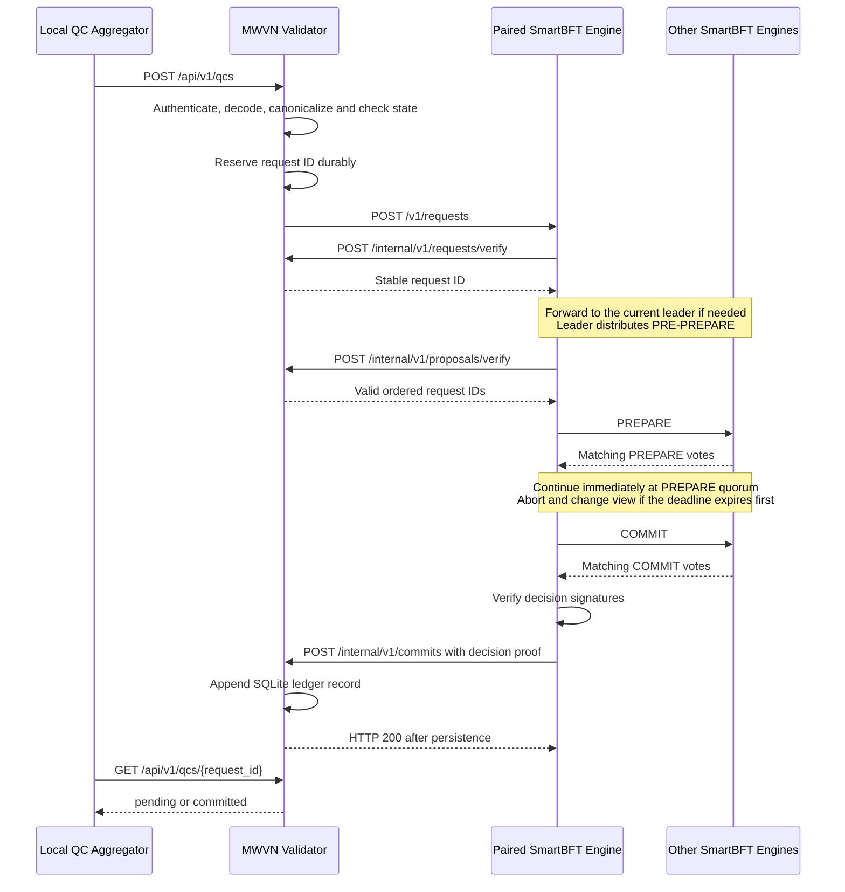

# MWVN SmartBFT Engine Design

## 1. Purpose and boundary

This fork turns the SmartBFT library into a runnable consensus-engine service for
the MWVN regional layer. The new Go application is `cmd/mwvn_bftnode`.

It is important to separate the responsibilities:

| Component | Responsibility |
|---|---|
| MWVN Regional Validator (Python, separate repository) | Receive a local QC, decode and validate it, apply expiry/replay/policy/state-machine rules, expose application status, and own the durable regional ledger. |
| `mwvn_bftnode` (Go, this repository) | Order requests already admitted by the Python validator, exchange authenticated SmartBFT messages with other engines, verify validator decision signatures, and return committed decisions to the paired validator. |
| SmartBFT library (Go, this repository) | Run the PBFT-family consensus protocol, including proposal, PREPARE, COMMIT, view change, batching, and write-ahead logging. |
| Regional deployment (separate repository) | Configure and run four Python validators and four paired Go engines, their membership, keys, containers, and end-to-end tests. |

The simulator and Local QC Aggregator call the Python Regional Validator. They do
not call a Go consensus engine directly. The Go application is not a complete
MWVN validator and does not know the witness-event or local-QC policy.



Each Regional Validator knows only its paired engine URL. Each Go engine knows
all Go peers from the shared membership file and knows only its paired Python
validator callback URL. The diagram uses Validator 1 as the example ingress and Engine 1 as the current
leader. If the ingress engine is not the leader, it forwards the request to the
current leader. Peer vote exchanges are summarized in notes to keep the diagram
readable; ledger writes are shown as local actions inside each Python validator.
After SmartBFT distributes a proposal, every engine asks its own paired validator
to verify the proposal; after the decision, every engine delivers the same
consensus-decided record to its paired validator's independent ledger.

## 2. Upstream SmartBFT v1.0.1 structure

Before the MWVN changes, the upstream tag `v1.0.1` had this top-level structure:

```text
SmartBFT/
├── .github/                 CI and repository automation
├── examples/
│   └── naive_chain/         Example embedding of the SmartBFT library
├── internal/
│   └── bft/                 Internal consensus protocol implementation
├── pkg/
│   ├── api/                 Dependency interfaces and metrics
│   ├── consensus/           Public consensus facade
│   ├── metrics/             Metrics providers
│   ├── types/               Public configuration and protocol types
│   └── wal/                 Write-ahead-log implementation
├── scripts/                 Upstream development scripts
├── smartbftprotos/          Consensus protocol protobuf definitions
├── test/                    Multi-node protocol and reconfiguration tests
├── vendor/                  Vendored Go dependencies
├── go.mod
├── go.sum
├── LICENSE
└── README.md
```

Upstream SmartBFT is a Go library. It defines the consensus algorithm and the
interfaces an embedding application must supply, but it does not provide an
MWVN-aware HTTP server, an MWVN membership file, or a Python validator.

## 3. Structure after the MWVN changes

The original directories remain. The fork adds a runnable adapter, documentation,
tests, and the configurable PREPARE deadline:

```text
SmartBFT/
├── cmd/
│   └── mwvn_bftnode/                 NEW: runnable Go consensus-engine adapter
│       ├── main.go                   process flags, startup and shutdown
│       ├── config.go                 membership, key loading and canonical data
│       ├── node.go                   SmartBFT interfaces, proposals and delivery
│       ├── transport.go              authenticated HTTP peer transport and trace
│       ├── callback.go               Go-to-Python validation/commit client
│       ├── server.go                 public and peer HTTP routes
│       ├── config_test.go            membership/configuration tests
│       ├── node_config_test.go       NEW: coordinated MWVN timer tests
│       └── Dockerfile                engine container image
├── docs/
│   ├── DESIGN.md                     NEW: consolidated design and API document
│   └── INSTALLATION.md               NEW: standalone build and test instructions
├── internal/bft/
│   ├── view.go                       CHANGED: PREPARE deadline behavior
│   ├── controller.go                 CHANGED: active-buffer request-timer guard
│   ├── requestpool.go                CHANGED: coordinated auto-remove scheduling
│   ├── util.go                       CHANGED: pass deadline into a view
│   └── prepare_timeout_test.go       NEW: focused timeout tests
├── pkg/
│   ├── consensus/consensus.go        CHANGED: propagate the setting
│   └── types/
│       ├── config.go                 CHANGED: public setting and validation
│       └── config_test.go            NEW: default and validation tests
├── test/
│   ├── prepare_timeout_test.go       NEW: four-node behavior tests
│   ├── strict_prepare_buffer_test.go NEW: timer-interaction regression tests
│   ├── reconfig.go                   CHANGED: retain setting on reconfiguration
│   └── test_app.go                   CHANGED: configure the default in tests
├── scripts/install-go.sh             NEW: local Go installation helper
├── Makefile                          NEW: focused MWVN test targets
└── README.md                         CHANGED: points to MWVN documentation
```

Deployment-only files are deliberately absent. The generated Compose files,
membership, development keys, and cross-repository end-to-end test live in
`mwvn-regional-deployment`. The full MWVN validation/state-machine code lives in
`mwvn-validator`.

## 4. The application added to use SmartBFT

### 4.1 Why an adapter was needed

SmartBFT is embedded through Go interfaces; it is not an HTTP service by itself.
`mwvn_bftnode` supplies the interfaces and process plumbing needed to operate one
independent engine:

- `Comm`: send consensus messages and forwarded transactions to known peers;
- `Signer`: sign proposals and view data with the node's Ed25519 identity;
- `Verifier`: delegate application/QC validation to the paired Python validator
  and verify SmartBFT validator signatures;
- `Assembler`: build a deterministic proposal from admitted requests;
- `Application`: deliver a committed proposal to the paired Python validator;
- `Synchronizer`: expose limited in-process state required by SmartBFT;
- `WAL`: persist SmartBFT protocol state.

The adapter starts one `consensus.Consensus` instance per process. A generated
`N`-validator deployment therefore runs `N` Go processes and `N` paired Python
processes. SmartBFT derives `N` from membership and calculates `f` and its safe
quorum. For the default `N=4`, it tolerates `f=1` Byzantine validator and
decides with quorum `3`; for `N=7`, it tolerates `f=2` and uses quorum `5`.

### 4.2 Request and decision flow



An HTTP `202` from `/v1/requests` means only that SmartBFT accepted the request
for processing. It is not proof of commitment. The client reads final state from
the Python validator API.

The diagram follows one paired validator and engine. Every engine verifies the
proposal with its own Python validator before voting and delivers the decided
record to that validator after consensus. Proposal verification therefore
appears before PREPARE, rather than after the COMMIT votes.

### 4.3 Membership and transport

At startup, `config.go` loads a strict JSON membership document containing:

- a network ID and membership version;
- at least four validator IDs;
- each engine's HTTP peer URL;
- each engine's Ed25519 public key.

`transport.go` sends protobuf SmartBFT messages and JSON forwarded requests over
HTTP. Every peer request carries the network ID, sender ID, and an Ed25519
signature covering the protocol domain, network ID, path, and exact body bytes.
This is suitable for an isolated experiment; production deployment still needs
TLS/mTLS, authorization, replay protection, secret management, and recovery.

## 5. Five-minute PREPARE vote buffer change

### 5.1 Exact semantics

The fork adds this public configuration field:

```go
PrepareVoteCollectionTimeout time.Duration
```

Its default is `5 * time.Minute`. It is a maximum deadline while a replica is
collecting matching PREPARE votes, not a mandatory five-minute sleep and not a
rolling batch window.

```text
Enter PREPARE collection
        |
        +-- required matching PREPARE votes arrive before deadline
        |       -> stop timer -> send COMMIT immediately
        |
        +-- deadline expires first
                -> complain about current view
                -> abort current view
                -> use SmartBFT's existing view-change recovery path
```

The deadline does not apply to COMMIT collection. It does not change quorum
calculation, request batching, signatures, message formats, or the existing
view-change safety rules. It coordinates request-driven timers with the active
PREPARE buffer, but it does not disable heartbeat failure detection.

### 5.2 Updated consensus algorithm

The change is implemented inside every replica's existing SmartBFT view. Let
`Q` be the quorum size calculated by SmartBFT. The replica's own PREPARE counts
toward `Q`, so `processPrepares` waits for `Q - 1` matching remote PREPARE votes.
For the deployment configurations used by this project, `N=4` gives `Q=3` and
`N=7` gives `Q=5`.

```text
Algorithm: PREPARE collection with a configurable maximum deadline

Input:
    current view v
    proposal sequence s
    accepted proposal p
    proposal digest d = Digest(p)
    requests R contained in p
    quorum size Q
    configured timeout T_prepare

1. Validate and accept PRE-PREPARE using the existing SmartBFT rules.
2. Create and broadcast this replica's PREPARE(v, s, d).
3. Publish ActivePrepare = {
       view: v,
       sequence: s,
       digest: d,
       requests: R,
       deadline: now + T_prepare
   }.
4. Start a one-shot timer for T_prepare.
5. While fewer than Q - 1 valid remote PREPARE votes have been collected:
       a. If the view is externally aborted:
              return ABORT.
       b. If the PREPARE timer expires:
              complain about view v;
              return ABORT so the existing view-change path can recover.
       c. If another protocol message arrives:
              process it using the existing SmartBFT message dispatcher.
       d. If a PREPARE vote arrives:
              accept it only for the current view, sequence and digest;
              rely on the existing vote set to reject duplicate voters;
              count the valid voter.
6. Quorum was reached before the deadline:
       stop the PREPARE timer;
       build the existing prepared record;
       broadcast COMMIT immediately;
       continue through the unchanged SmartBFT COMMIT phase.
7. On every exit, clear ActivePrepare only if its view, sequence and digest
   still identify this exact proposal.
```

The algorithm therefore has no successful path containing `sleep(5 minutes)`.
With all required votes available, the transition from PREPARE to COMMIT is
immediate. Five minutes is the failure deadline for missing PREPARE votes.

The following state transition summarizes the behavior:

```text
PRE-PREPARE accepted
        |
        v
PREPARE_COLLECTING -- Q reached --> PREPARED --> COMMIT_COLLECTING
        |                                      |
        |                                      +-- commit quorum --> DECIDED
        |
        +-- T_prepare expired --> ABORT --> existing VIEW_CHANGE
        |
        +-- leader heartbeat failed ------> existing VIEW_CHANGE
```

COMMIT collection is intentionally outside the five-minute PREPARE deadline.
It retains the existing SmartBFT behavior and safety checks.

### 5.3 Coordinated request-timer algorithm

SmartBFT also has request-pool timers that are independent of the consensus
phase timer. The fork coordinates them with the exact active proposal:

```text
Algorithm: handle leader-forwarding timeout for request r

1. Read the current view and its ActivePrepare record.
2. A match exists only when all of the following are true:
       - RequestTimerGuardDuringPrepare is enabled;
       - ActivePrepare belongs to the current view;
       - r is one of the requests in that proposal;
       - the ActivePrepare deadline is still in the future.
3. If there is no exact match, execute the original SmartBFT behavior:
       - the leader stops its request-driven heartbeat sending; or
       - a follower complains about the current leader.
4. If there is an exact match:
       - do not generate a request-driven leader complaint;
       - if this replica is the leader, keep its heartbeats running;
       - return the remaining PREPARE-buffer duration to the request pool;
       - postpone the start of the normal auto-remove interval by that
         remaining duration.
5. Do not suppress the independent heartbeat failure detector. A silent or
   disconnected leader can still be replaced before T_prepare expires.
```

The request identity check is important: a long-running proposal cannot protect
an unrelated request from its normal timeout behavior. The view, sequence and
digest checks similarly prevent stale buffer state from affecting a later
proposal.

### 5.4 Timer values and precedence

The MWVN adapter derives its request timers from the configured PREPARE
deadline. These are durations for their respective timer stages, not timestamps
measured from initial submission.

| Timer or guard | MWVN value with `-prepare-timeout 5m` | Behavior |
|---|---:|---|
| `PrepareVoteCollectionTimeout` | `5m` | Maximum time to obtain the PREPARE quorum. Quorum ends the wait immediately. |
| `RequestComplainTimeout` | `5m30s` | Provides 30 seconds of grace beyond the configured PREPARE deadline. |
| `RequestAutoRemoveTimeout` | `6m` | Provides one minute of grace; its normal interval starts only after any active-buffer postponement. |
| `RequestTimerGuardDuringPrepare` | `true` in `mwvn_bftnode` | Suppresses only request-driven complaints matching the active proposal. The generic library default remains `false`. |
| `LeaderHeartbeatTimeout` | `1m` | Remains independent and can replace a genuinely failed leader before five minutes. |

Precedence is intentional:

1. A PREPARE quorum wins immediately and advances to COMMIT.
2. A real heartbeat failure can trigger view change early.
3. A matching request-pool complaint cannot interrupt a healthy active PREPARE
   buffer.
4. If neither quorum nor an independent failure occurs, the PREPARE deadline
   aborts the view and invokes normal recovery.

### 5.5 Timer coordination rationale

The original implementation had an interaction bug: a request complaint could
make the leader stop sending heartbeats while the proposal was legitimately
waiting for PREPARE votes. Followers could then change view before the PREPARE
deadline. The correction uses two complementary controls:

1. `mwvn_bftnode` enables the opt-in
   `RequestTimerGuardDuringPrepare` setting and derives its request timers from
   the configured PREPARE timeout. With the normal `5m` value,
   `RequestComplainTimeout` is `5m30s` and `RequestAutoRemoveTimeout` is `6m`.
   The generic SmartBFT defaults are not changed.
2. Each view publishes a thread-safe active-buffer record containing the exact
   view, sequence, proposal digest, request identities, and deadline. If a
   request timer still expires during that exact buffer, the controller keeps
   leader heartbeats running, suppresses the request-driven complaint, and
   postpones the normal auto-remove interval until after the buffer deadline.

The guard is deliberately narrow. It does not match an unrelated request or a
different proposal, and it is removed immediately when quorum arrives, the
deadline expires, or the view aborts. `LeaderHeartbeatTimeout` remains active,
so a genuinely crashed or disconnected leader can still be replaced before the
PREPARE deadline. Once the PREPARE deadline expires, the normal SmartBFT
complaint and view-change path runs; completion of the view change may take an
additional configured view-change interval.

### 5.6 Implementation changes

| File | Change |
|---|---|
| `pkg/types/config.go` | Defines the timeout and opt-in request-timer guard, sets the five-minute timeout default, and rejects zero/negative timeout values. The generic guard default remains disabled for compatibility. |
| `pkg/consensus/consensus.go` | Copies the public setting into internal protocol parameters. |
| `internal/bft/util.go` | Propagates the setting when constructing a view. |
| `internal/bft/view.go` | Starts the timer in `processPrepares`, publishes the exact active-buffer identity, and clears it on every exit; quorum proceeds immediately and expiry complains and aborts. |
| `internal/bft/controller.go` | Suppresses only request-driven complaints for the exact active buffer and keeps leader heartbeats running. Heartbeat failure detection is unchanged. |
| `internal/bft/requestpool.go` | Starts the normal auto-remove interval after any active-buffer postponement instead of allowing request removal during the buffer. |
| `cmd/mwvn_bftnode/main.go` | Exposes `-prepare-timeout`, default `5m`. |
| `cmd/mwvn_bftnode/node.go` | Assigns the command-line value and derives MWVN request complaint/removal timers from it. |

The same change set also removed the four-node-only restriction in the MWVN
adapter. Membership now requires at least four distinct nodes, and SmartBFT
continues to compute the quorum from the configured membership. This is why the
same engine image was tested successfully with both four and seven validators;
the consensus node count is not hard-coded in the PREPARE algorithm.

Configuration example:

```bash
mwvn_bftnode \
  -id 1 \
  -listen :8200 \
  -membership /config/membership.json \
  -private-key /run/secrets/node-1.key \
  -core-url http://regional-validator-1:8080 \
  -data-dir /data \
  -prepare-timeout 5m
```

Tests use short deadlines so failure/recovery scenarios finish quickly. The
normal cluster test retains the real `5m` configuration and proves consensus
completes as soon as quorum is available rather than waiting five minutes.
`test/strict_prepare_buffer_test.go` additionally proves that delayed PREPARE
votes do not trigger the old request/heartbeat view change, expiry occurs before
view-change recovery, and a real leader failure is still detected before the
PREPARE deadline. The focused unit tests also verify exact request/proposal
matching and auto-remove postponement.

### 5.7 Relationship to MWVN Algorithm 3

This fork is an adaptation of the paper's latency-buffered PREPARE step to the
studied SmartBFT PBFT-family implementation; it is not a literal replacement of
SmartBFT with the paper's pseudocode.

| MWVN Algorithm 3 concept | SmartBFT implementation in this fork |
|---|---|
| Broadcast PREPARE | Existing signed SmartBFT PREPARE broadcast. |
| Buffer votes over a five-minute window | Maximum `PrepareVoteCollectionTimeout`; the implementation exits early at quorum. It is not a mandatory or rolling five-minute delay. |
| Wait for matching PREPARE votes | Existing per-view vote set plus digest/view/sequence checks; the local vote counts, so the loop waits for `Q - 1` remote votes. |
| Broadcast COMMIT | Existing SmartBFT COMMIT transition, reached immediately after PREPARE quorum. |
| Decide after COMMIT quorum | Existing SmartBFT decision and delivery path. |
| Aggregate validator signatures via BLS | Not added by this change. The demo retains SmartBFT's existing decision-proof representation; BLS aggregation remains separate work if required. |

The modification does not move PBFT traffic onto AIS or VDES. The regional
validators and SmartBFT engines communicate over the configured IP transport.
The proposal entering this algorithm is an already admitted regional-validator
record; witness collection and Local QC construction happen before this stage.

### 5.8 Safety and liveness properties preserved

- Only votes matching the current view, sequence and proposal digest count.
- The existing vote set prevents one validator from being counted repeatedly.
- No COMMIT is sent until the configured PREPARE quorum is reached.
- Timeout causes abort and view change; it never converts a partial vote set
  into a decision.
- The timer guard changes liveness coordination only. It does not change quorum
  size, authentication, proposal verification or decision validity.
- The active-buffer record is cleared on success, timeout, external abort and
  view termination, preventing it from leaking into a later proposal.
- Independent heartbeat monitoring remains active, preserving early recovery
  from a genuinely unavailable leader.

### 5.9 Real-process verification

The correction was also verified with four independent Go engines, four paired
Python validators, signed HTTP peer relays, separate WAL directories, and
separate SQLite ledgers:

| Scenario | Observed result |
|---|---|
| PREPARE messages held for 3 seconds | No COMMIT while held; release produced a common four-ledger commit in 3.37 seconds, without waiting for the five-minute deadline. |
| PREPARE messages held through the deadline | No COMMIT or ledger append during the hold. All four engines logged the `5m0s` PREPARE timeout before their first view change. Release recovered and committed a common record in 304.42 seconds. |
| Leader disconnected during an active scaled buffer | The independent heartbeat detector changed view before the PREPARE deadline. |

In the full five-minute run, node 1 entered PREPARE collection at
`08:33:56.926`, timed out at `08:38:56.930`, and changed view at
`08:38:56.984`. This confirms that a healthy view no longer changes because a
request timer stopped its heartbeats. It does not change the separate rule that
a genuinely unavailable leader may be replaced earlier.

The generated deployment was additionally exercised with both supported test
sizes after this commit:

| Membership | Fault bound | Quorum | Live result |
|---:|---:|---:|---|
| 4 | 1 | 3 | Four validators and four engines became healthy; all four ledgers committed the same record hash. |
| 7 | 2 | 5 | Seven validators and seven engines became healthy; all seven ledgers committed the same record hash. |

These runs verify dynamic membership and normal early-quorum operation. They do
not replace the dedicated delayed-PREPARE and full five-minute tests described
above.

## 6. HTTP API summary

This section consolidates the engine's HTTP surface in the design document.
Implementation routes are defined in `cmd/mwvn_bftnode/server.go`; callbacks are
defined in `cmd/mwvn_bftnode/callback.go`.

### 6.1 Python validator to Go engine

| Method | Path | Purpose | Success |
|---|---|---|---|
| `GET` | `/v1/health` | Engine readiness and node ID. | `200`; `503` while starting |
| `GET` | `/v1/status` | Node-local leader, membership, paired-ledger state, and PREPARE deadline. | `200` |
| `POST` | `/v1/requests` | Submit one request already admitted by the Python validator. | `202 pending` |
| `GET` | `/v1/trace?after=0&limit=500` | Read bounded node-local protocol trace events. | `200` |

Minimal submission example:

```http
POST /v1/requests
Content-Type: application/json

{
  "schema_version": "mwvn-approved-qc/v2",
  "request_id": "request-001",
  "qc_id": "qc-001",
  "claim_hash": "7a9e667f3b8d94b7c0c5f590a8a2c26d662f8e86d73e631cdd8c39f24f40a9b4"
}
```

```json
{
  "state": "pending",
  "request_id": "request-001",
  "node_id": 1
}
```

### 6.2 Go engine to its paired Python validator

| Method | Path | Purpose |
|---|---|---|
| `GET` | `/internal/v1/state` | Read paired node ID, application-ledger height, and head hash. |
| `POST` | `/internal/v1/requests/verify` | Deterministically validate one submitted request and return its ID. |
| `POST` | `/internal/v1/proposals/verify` | Validate proposal contents and application-ledger linkage. |
| `POST` | `/internal/v1/commits` | Deliver the decided record and verified SmartBFT decision proof for durable storage. |

These callback endpoints are implemented by `mwvn-validator`, not by this Go
repository.

### 6.3 Go engine peer API

| Method | Path | Body | Purpose |
|---|---|---|---|
| `POST` | `/internal/v1/consensus` | SmartBFT protobuf | Deliver PRE-PREPARE, PREPARE, COMMIT, view-change, heartbeat, and state-transfer protocol messages. |
| `POST` | `/internal/v1/transaction` | JSON application request | Forward a request to the current leader. |

Both routes require `X-MWVN-Network`, `X-MWVN-Sender`, and
`X-MWVN-Signature`. They are private engine-to-engine routes; neither the
simulator nor the Python validator should call them.

## 7. Persistence and current limitations

The Go engine persists SmartBFT protocol data in its WAL. The Python validator
persists the application ledger. The common application record hash excludes a
node-local decision-proof subset because two honest nodes can hold different
valid 3-of-4 signature subsets for the same decision.

Current limitations are intentional and must remain visible:

- restart from a non-empty SmartBFT WAL/application ledger is not implemented;
- state transfer is not integrated into the application ledger;
- Python-to-Go and Go-to-Python HTTP calls are not authenticated;
- peer HTTP is signed but not encrypted and has no replay protection;
- keys in the deployment repository are development-only;
- the engine orders admitted opaque requests; it does not implement MWVN QC
  validation or the MWVN conflict-preserving state machine.

## 8. Repository relationships

```text
mwvn-local-aggregator
    -> sends local QCs to mwvn-validator

mwvn-validator
    -> owns MWVN rules and the application ledger
    -> calls one SmartBFT engine through this repository's API

SmartBFT (this repository)
    -> owns the consensus protocol and mwvn_bftnode adapter

mwvn-regional-deployment
    -> assembles four mwvn-validator instances and four SmartBFT engines
```

Keeping these boundaries allows the PBFT-family engine to be replaced later
without moving MWVN validation policy into the consensus library.
